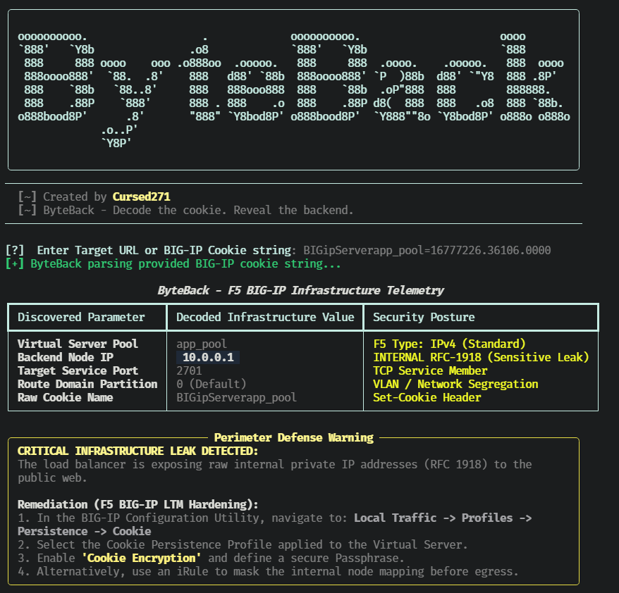
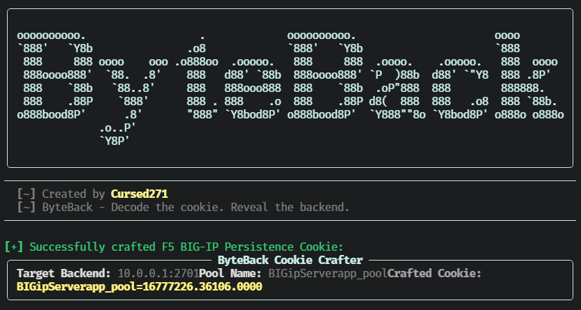

<div align="center">

  

  <h1>ByteBack</h1>

  <p align="center">
    
  </p>

  <p align="center">
    
    
    
    
    <a href="./LICENSE">
      
    </a>
  </p>

  <p>Decode the Cookie. Reveal the Backend.</p>

</div>


## Overview

ByteBack is a Python utility for authorized F5 BIG-IP persistence-cookie analysis and infrastructure assessment.

It can retrieve BIG-IP persistence cookies from an authorized HTTP endpoint, decode supported cookie formats, present backend addressing metadata in a terminal table, identify potential internal-address exposure, and construct IPv4 cookie values for controlled testing workflows.

> ByteBack is a cookie-analysis and assessment utility. It does not exploit a vulnerability, bypass authentication, or guarantee that a decoded address is reachable. Treat decoded infrastructure data as sensitive and validate it only within an authorized scope.

## Features

| Capability | What it does |
| :--- | :--- |
| Cookie retrieval | Requests an authorized URL and collects BIG-IP-related cookies from response cookies and `Set-Cookie` headers. |
| Cookie decoding | Parses supported F5 BIG-IP persistence-cookie formats into address, port, pool, and route-domain metadata. |
| IPv4 decoding | Decodes standard IPv4 persistence-cookie values using little-endian address and reversed port-byte encoding. |
| Route-domain decoding | Handles `rd`-prefixed values for IPv4 and IPv6 route-domain formats. |
| IPv6 decoding | Handles `vi`-prefixed IPv6 cookie values. |
| Address classification | Identifies private, loopback, or reserved addresses as potentially sensitive internal disclosures. |
| Terminal reporting | Displays pool name, decoded IP, port, route domain, cookie name, and address classification. |
| IPv4 cookie construction | Creates an IPv4 BIG-IP persistence-cookie string from a supplied address, port, and pool name. |

## Screenshots:

### Generator


### Decoder


## Cookie Formats

| Format | Example structure | ByteBack behavior |
| :--- | :--- | :--- |
| Standard IPv4 | `BIGipServer<pool>=<encoded-address>.<encoded-port>.0000` | Decodes address and port; assigns route domain `0 (Default)`. |
| Route-domain IPv4 | `BIGipServer<pool>=rd<id>o<encoded-address>o<port>` | Decodes the route-domain ID, address, and port. |
| Route-domain IPv6 | `BIGipServer<pool>=rd<id>o<encoded-IPv6>o<port>` | Decodes the route-domain ID, IPv6 address, and port. |
| IPv6 | `BIGipServer<pool>=vi<encoded-IPv6>.<encoded-port>` | Decodes the IPv6 address and port; assigns route domain `0 (Default)`. |

Cookie names beginning with `BIGipServer` have that prefix removed for the displayed pool name. Other cookie names are retained as supplied.

## Technology

| Component | Purpose |
| :--- | :--- |
| Python | Application runtime |
| Typer | Command-line interface and help |
| Rich | Banner, status indicator, panels, and result tables |
| requests | Authorized HTTP endpoint retrieval |
| urllib3 | TLS warning suppression for assessment workflows |
| ipaddress | Address validation and private-address classification |
| struct | Integer, address, and port byte-order conversion |
| re | `Set-Cookie` header pattern matching |

## Installation

### Prerequisites

- Python 3 with `pip`.
- Network access to the authorized target endpoint when using URL-based retrieval.
- Permission to assess the target application and infrastructure.

Install dependencies:

```bash
python3 -m pip install rich typer requests urllib3
```

Clone and display help:

```bash
git clone https://github.com/Cursed271/ByteBack.git
cd ByteBack
python3 ByteBack.py --help
```

Use an isolated Python environment. If your environment uses `python` rather than `python3`, substitute that interpreter consistently.

## Usage

Use ByteBack only against applications, load balancers, and infrastructure you are explicitly authorized to assess.

### Decode a Cookie

```bash
python3 ByteBack.py decode -t "BIGipServerapp_pool=123456789.12345.0000"
```

### Retrieve Cookies From a URL

```bash
python3 ByteBack.py decode -t https://authorized-target.example/
```

### Construct an IPv4 Cookie

```bash
python3 ByteBack.py craft --ip 192.168.1.10 --port 8080 --pool app_pool
```

### Display Help

```bash
python3 ByteBack.py --help
```

## Command-Line Options

### `decode`

| Option | Short | Default | Purpose |
| :--- | :--- | :--- | :--- |
| `--target` | `-t` | Interactive prompt | Authorized URL or raw BIG-IP cookie string |
| `--help` | `-h` | — | Show help |

### `craft`

| Option | Short | Default | Purpose |
| :--- | :--- | :--- | :--- |
| `--ip` | `-i` | Required | IPv4 address to encode |
| `--port` | `-p` | Required | TCP service port to encode |
| `--pool` | — | `app_pool` | Pool-name suffix for the constructed cookie |
| `--help` | `-h` | — | Show help |

## Output & Interpretation

### Terminal Output

ByteBack displays one result block for each decoded cookie.

| Field | Meaning |
| :--- | :--- |
| Virtual Server Pool | Pool name derived from the cookie name |
| Backend Node IP | Decoded backend address |
| Target Service Port | Decoded TCP service port |
| Route Domain Partition | Route-domain identifier or default designation |
| Raw Cookie Name | Original cookie name |
| Security Posture | Address classification and format-specific context |

### Address Classification

| Classification | Meaning |
| :--- | :--- |
| `INTERNAL RFC-1918 (Sensitive Leak)` | Decoded address is private, loopback, or reserved |
| `PUBLIC / ROUTABLE` | Decoded address is not classified as private, loopback, or reserved |
| `UNKNOWN` | Address validation could not complete |

A private or reserved decoded address does not automatically prove that the address is reachable, vulnerable, or incorrectly configured. It is an exposure indicator that requires correlation with routing, firewall, segmentation, and application context.

## Internal-Exposure Guidance

When ByteBack identifies a private, loopback, or reserved address, it presents a perimeter-defense warning and recommends reviewing the applicable F5 BIG-IP cookie-persistence profile.

Potential defensive actions include:

- Reviewing cookie persistence profiles applied to the affected virtual server.
- Enabling cookie encryption where appropriate for the environment.
- Reviewing whether internal node mapping is exposed through persistence cookies.
- Using an appropriate application-layer control or iRule to prevent unnecessary internal-address disclosure.
- Validating the finding against the BIG-IP configuration, network design, and authorized assessment scope.

Do not treat a decoded internal address as confirmed compromise or confirmed reachability. Confirm the finding through authorized configuration review and controlled validation.

## Known Limitations

- URL retrieval disables TLS certificate verification and follows redirects.
- The tool searches response cookies and the first `Set-Cookie` header; it does not perform exhaustive multi-header or JavaScript-based cookie discovery.
- Cookie parsing is format-specific and may fail on encrypted, obfuscated, customized, or unsupported persistence-cookie formats.
- The `craft` command supports IPv4 addresses only.
- The crafted value is intended for authorized testing and does not establish reachability or bypass access controls.
- No JSON, CSV, or file-based report export is implemented.
- No proxy, authentication, custom-header, retry, or rate-limiting controls are exposed through the CLI.
- Decoded values can reveal sensitive infrastructure information and should be handled as confidential assessment data.

## Safe Use

- Obtain explicit authorization before querying an application or analyzing its cookies.
- Prefer supplying an already collected cookie string when possible.
- Use a controlled test endpoint rather than production infrastructure where feasible.
- Do not use crafted cookies against systems outside the authorized scope.
- Protect terminal output, screenshots, notes, and any decoded infrastructure data.
- Validate exposure findings through configuration review and authorized network testing.
- Do not assume that a decoded backend address is exploitable or reachable.

## Troubleshooting

| Problem | What to check |
| :--- | :--- |
| No cookies found | Whether the target issues a BIG-IP persistence cookie and whether the request succeeds |
| Connection failure | URL correctness, DNS resolution, proxy requirements, and network access |
| Decoding error | Cookie format, route-domain prefix, IPv6 format, and address/port encoding |
| Unexpected address classification | Address validity, private-address ranges, and reserved-address behavior |
| Craft command fails | IPv4 format, valid port range, and required options |
| TLS warning suppressed | Intentional behavior for assessment workflows; review certificate validation requirements before production use |

## Version History

| Version | Scope |
| :--- | :--- |
| Version 1 | F5 BIG-IP cookie retrieval, IPv4/IPv6 and route-domain decoding, internal-address classification, and IPv4 cookie construction |

## License & Usage

ByteBack is distributed under the CursedSec Ownership Edict (COE).

Read [LICENSE](./LICENSE) for the applicable permissions, restrictions, contribution terms, and disclaimers. Public source availability is not a substitute for those terms.

## Feedback & Contributions

Use the repository's bug-report or feature-request template when issue submission is available.

Include the version, operating system, sanitized command, cookie format, and reproduction steps. Never publish client URLs, decoded internal addresses, credentials, or sensitive infrastructure details.

Check the security-reporting instructions before disclosing a vulnerability. Review the license and contribution terms before submitting modifications.

## Connect & Collaborate

<div align="center">

  <a href="https://github.com/Cursed271">
    
  </a>
  <a href="https://www.cursedsec.com/">
    
  </a>
  <a href="https://www.linkedin.com/in/cursed271/">
    
  </a>

  <p>Decode with permission. Validate with care. Protect the backend.</p>
  <sub>CursedSec.com · Cursed271 · ByteBack</sub>

</div>


